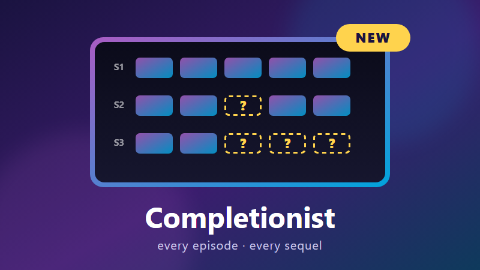

<p align="center">
  
</p>

<h1 align="center">Completionist for Jellyfin</h1>

<p align="center">
  Finds the TV seasons and episodes that have aired, and the films from your collections that have been released,
  but aren't in your library. Tells you on Discord when something new goes missing.
</p>

<p align="center">
  <a href="https://github.com/TNT24/jellyfin-completionist/releases/latest"></a>
  
  
</p>

---

## What it does

**TV shows.** Every show in your TV libraries is compared with an episode guide:

| Situation | What you see |
|---|---|
| You have seasons 1–2, season 3 has aired | **Season 3: all 10 episodes missing** |
| S02E05 is missing from a season you otherwise have | **S02E05 · "Title" · aired 15 Sep 2013** |
| A new episode aired two days ago and hasn't arrived | Listed and tagged **NEW**, and posted to Discord |
| An episode airs next week | Nothing. Only aired episodes count, after a grace period you choose. |
| No guide knows the show (home videos, obscure anime) | Checked for gaps in your own numbering: having 1, 2 and 4 means 3 is missing |

**Film collections.** For every franchise you own at least one film of, and every Jellyfin collection with a TMDb id, the plugin lists the released films you don't have:

| Situation | What you see |
|---|---|
| You have Back to the Future 1 and 3 | **Back to the Future Collection**: you have 2 of 3 · missing *Back to the Future Part II (1989)* |
| A sequel came out in cinemas last month | Nothing yet. Films count 90 days after release (configurable), when they usually reach streaming and disc. |
| A sequel is announced with no date | Nothing. |

Film collections use TMDb, the same data Jellyfin's own collections come from, so they **need a free TMDb API key**.

## Features

- **Its own page in the dashboard menu.** Totals, then **TV shows** and **Films** tabs with search, sorting, NEW tags, and **Ignore** buttons for a show, a collection or a single film.
- **Discord tells you what's new.** Discord hears about an episode that aired or a film that came out since the last check, or something that disappeared from your library. It doesn't hear about the same old gaps every day. The first check sends a one-message summary instead of flooding the channel.
- **Optional "caught up" messages** when you fill a gap. If your server is reachable from the internet, messages link to the show or collection and show its poster; film messages otherwise link to TMDb.
- **TV works with no key.** It uses [TVmaze](https://www.tvmaze.com/api) by default. With a TMDb key, TMDb is asked first, which matches Jellyfin's built-in episode numbering and includes specials.
- **Runs by itself.** A daily scheduled task, a quick check after every library scan (lookups are cached), and a **Check now** button.
- **Doesn't cry wolf.** If a show's numbering doesn't line up with the guide at all (absolute-order anime, seasons numbered by year, a mismatched show), it isn't reported as entirely missing. It's listed under *Shows that couldn't be checked* with the reason. If TVmaze or TMDb can't be reached, the last result is kept.

---

## Installation

### From the plugin repository (recommended)

1. In Jellyfin, open **Dashboard → Plugins → Repositories** and click **+**.
2. Add the repository:
   - **Name:** `Completionist`
   - **URL:**
     ```
     https://raw.githubusercontent.com/TNT24/jellyfin-completionist/main/manifest.json
     ```
3. Go to **Catalog**, find **Completionist** under *General*, and click **Install**.
4. **Restart Jellyfin.**

Jellyfin picks the build that matches your server version.

### Manually

Download the zip for your server version from the [latest release](https://github.com/TNT24/jellyfin-completionist/releases/latest), unzip it into a `Completionist_<version>` folder inside Jellyfin's `plugins` folder, and restart Jellyfin.

| Server | Zip |
|---|---|
| Jellyfin 12.x | `Completionist_<version>_jellyfin-12.zip` |
| Jellyfin 10.11.x | `Completionist_<version>_jellyfin-10.11.zip` |

---

## Setup

1. Open **Dashboard → Completionist**.
2. **Discord:** in your Discord channel, go to *Edit Channel → Integrations → Webhooks → New Webhook*, copy the URL, paste it in, and press **Send test message**.
3. **Films:** get a free API key at [themoviedb.org → Settings → API](https://www.themoviedb.org/settings/api) and paste it into *TMDb API key*. Either the short v3 key or the long read access token works.
4. Press **Save**, then **Check now**. The first check looks everything up (about one second per show or collection). After that, results come from the cache.

### Settings

| Setting | Default | |
|---|---|---|
| Check TV shows | On | |
| Wait this many days after an episode airs | 2 | Gives downloads time to arrive. |
| Report seasons I have none of | On | Turn off if you only keep some seasons of a show on purpose. |
| Include specials | Off | Needs a TMDb key; TVmaze doesn't number specials. |
| Check unknown shows for gaps | On | For shows no guide knows, or whose numbering doesn't match. |
| Check film collections | On | Needs a TMDb key. |
| Wait this many days after a film's release | 90 | TMDb's date is usually the cinema release. |
| TMDb API key | (empty) | Needed for films, optional for TV. |
| Also post when missing items turn up | Off | |
| Public server address | (empty) | Adds links and posters to Discord messages. |
| Libraries | All TV and movie libraries | |
| Check after each library scan | On | |

## FAQ

**A show is listed as missing a season I don't want.** Press *Ignore this show*, or turn off *Report seasons I have none of*.

**A collection lists a short film, documentary or spin-off I don't care about.** Press *Ignore* next to that film, or *Ignore this collection*.

**A show is under "Shows that couldn't be checked".** It has no TMDb, TheTVDB or IMDb id, or its numbering doesn't match the guide. *Identify* or *Refresh metadata* on the show usually fixes the first. For the second, gaps are still checked.

**A film I own shows as missing.** It needs a TMDb id in Jellyfin. Use *Identify* on it, or *Refresh metadata*.

**I deleted something on purpose.** It shows up as new once. Ignore it if that's permanent.

**Does it download anything?** No. It only reports what's missing.

## Building

Needs the .NET 10 SDK (which also builds the .NET 9 target).

```powershell
.\package.ps1
```

This runs the tests for both Jellyfin lines, builds both, writes the zips to `dist\` and updates `manifest.json`. See [DEVELOPMENT.md](DEVELOPMENT.md) for how it works.
